# 음식명 예측 단계 개선: 음식 분류기 + Gemini 폴백

작성일 2026-09-28 · 프로젝트 `diet-management/n296_stage3`

## 요약

- 파이프라인의 "이미지 → 음식명" 단계를 **음식 분류기 → 확신도 0.7 미만이면 Gemini(gemini-3.5-flash-lite)** 로 바꿨다.
  이어서 Gemini 가 재료를 예측하고, 음식명과 재료를 합친 텍스트를 임베딩해 영양 모델에 넣는다.
- 분류기는 AIHub 122 음식분류 이미지 **109종, 21,539장**으로 학습했다 (ConvNeXt-Tiny).
  **test top-1 88.8%, top-5 98.2%**. 확신도 0.7 기준에서 사진의 89.4% 를 분류기가 처리하고 그 정확도는 94.1% 다.
  나머지 10.6% 는 Gemini 로 넘어간다.
- **한계: 분류기가 모르는 음식에도 확신도가 높게 나온다.** 109종에 없는 `test_dataset_296` 19종 사진의
  31.9% 가 확신도 0.7 이상이라 Gemini 를 거치지 않는다.
- **영양 모델도 새로 학습했다** (10절). 같은 109종 사진과 "음식명 (재료: …)" 텍스트를 썼다.
  - 학습한 음식의 다른 사진: mean PMAE **3.8%**. 음식마다 정답이 하나라 사실상 1인분 값을 외운 결과다.
  - 처음 보는 음식 16종: **43.8%**. 평균값만 예측하는 기준선(48.2%)보다 조금 나은 수준이다.
    분류기 밖 음식(Gemini 로 넘어가는 음식)의 영양값은 믿기 어렵다.

시각화 노트북 (둘 다 실행 완료)
- [`notebooks/food_classifier_results.ipynb`](notebooks/food_classifier_results.ipynb): 분류기 (그림 `runs/food_cls_122/figures/`)
- [`notebooks/nutrition_cls109_results.ipynb`](notebooks/nutrition_cls109_results.ipynb): 영양 모델 (그림 `runs/nutrition_cls109/figures/`)

---

## 1. 배경: Gemini 만으로 음식명을 예측했을 때

기존 파이프라인은 Gemini 가 사진만 보고 음식명과 재료를 추출했다. 힌트 없이(zero-shot) 예측시켜 음식별로 2장씩 직접 판정했다.

| 모델 | 판정 장수 | 정답 | 부분정답 | 오답 | 결과 파일 |
|---|---|---|---|---|---|
| gemini-3.1-flash-lite | 32 (16종) | 6 | 11 | 15 | `gemini_food_pred/sample2_per_food_judged.*` |
| gemini-3.5-flash-lite | 38 (19종) | 8 | 13 | 17 | `gemini_food_pred_3.5-flash-lite/sample2_per_food_judged.*` |

- 같은 이미지 21장으로 비교하면 3.5 가 2장 더 맞혔고(감자만두, 크림함박스테이크) 더 나빠진 경우는 없었다.
- 재료는 음식명보다 정확했다. 등갈비찜 → 닭볶음탕, 감자옹심이 → 떡국처럼 세분화된 한식은 두 모델 모두 틀렸다.
- 무료 등급 한도: 3.1-flash-lite 는 하루 500회·분당 15회, 3.8-flash 는 하루 20회라 대량 예측에 쓸 수 없었다.

이 결과를 보고 학습한 분류기가 먼저 음식명을 내고, 자신 없을 때만 Gemini 를 쓰는 구조로 바꿨다.

## 2. 데이터: AIHub 122 음식분류 이미지 일부

- AIHub 122(datasetkey 74)의 음식분류 이미지는 전체 약 1.6TB 이고, **zip 파일 단위로만** 받을 수 있다
  (서버가 Range 요청을 지원하지 않아 zip 안의 일부만 받을 수 없음).
- Validation zip 은 음식 대분류별로 나뉘어 있다(예: `09_10.zip` = 조림·튀김). 50GB 안에서 음식 종류가 가장 많은 조합을
  골랐다: **`02_03_05.zip` + `09_10.zip` = 48GB, 109종**.
- 음식 코드 → 음식명은 영양DB 행 순서로 연결했다(`build_manifest_122.classification_code2name`, 정렬 순서 대응 [추정]).
- 분할: 사진 파일명 끝 `_0/_1` 만 다른 것을 한 그룹으로 묶어 train/val/test = 8:1:1.

| 대분류 | 음식 종류 | train | val | test |
|---|---|---|---|---|
| 면류 | 43 | 6,843 | 856 | 847 |
| 조림 | 20 | 3,192 | 404 | 396 |
| 죽 | 13 | 2,061 | 263 | 259 |
| 찜 | 13 | 1,999 | 257 | 256 |
| 튀김 | 20 | 3,126 | 386 | 394 |
| **합계** | **109** | **17,221** | **2,166** | **2,152** |

그룹이 거의 1장씩이다(16,433그룹 / 17,221장). 그래서 같은 음식을 다른 시각에 찍은 사진은 train 과 test 에
함께 들어갈 수 있고, test 정확도가 실제보다 조금 높게 나올 수 있다.

## 3. 분류기 학습

| 항목 | 값 |
|---|---|
| 모델 | timm `convnext_tiny.fb_in22k_ft_in1k` (ImageNet-22k 사전학습), 109 클래스 |
| 입력 | 384px 로 줄인 사본, 학습 288px RandomResizedCrop + TrivialAugment + RandomErasing |
| 학습 | AdamW lr 1e-4, weight decay 0.05, cosine (1 epoch warmup), label smoothing 0.1, AMP, batch 64 |
| epoch | 30 (best 28), GPU L4 1장, 약 40분 |
| 확신도 보정 | val 로 temperature 를 맞춤: **T = 0.82** |

YOLO 대신 timm 을 쓴 이유: YOLO(ultralytics)는 다른 가상환경에만 설치돼 있다. 영양 모델과 Gemini 코드가 있는
`diet` 환경에서 파이프라인을 한 번에 돌리려고 같은 환경의 timm 을 썼다.

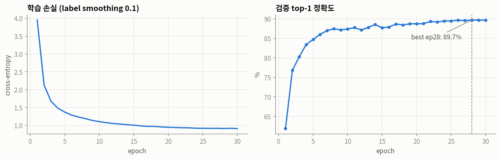

검증 정확도는 epoch 7 에 87%, 28 에 89.7% 로 수렴했다.

## 4. 결과

### 4.1 정확도와 확신도 기준

| | top-1 | top-5 | ECE (보정 후) |
|---|---|---|---|
| val (2,166장) | 89.7% | 98.3% | 0.022 |
| **test (2,152장)** | **88.8%** | **98.2%** | **0.026** |

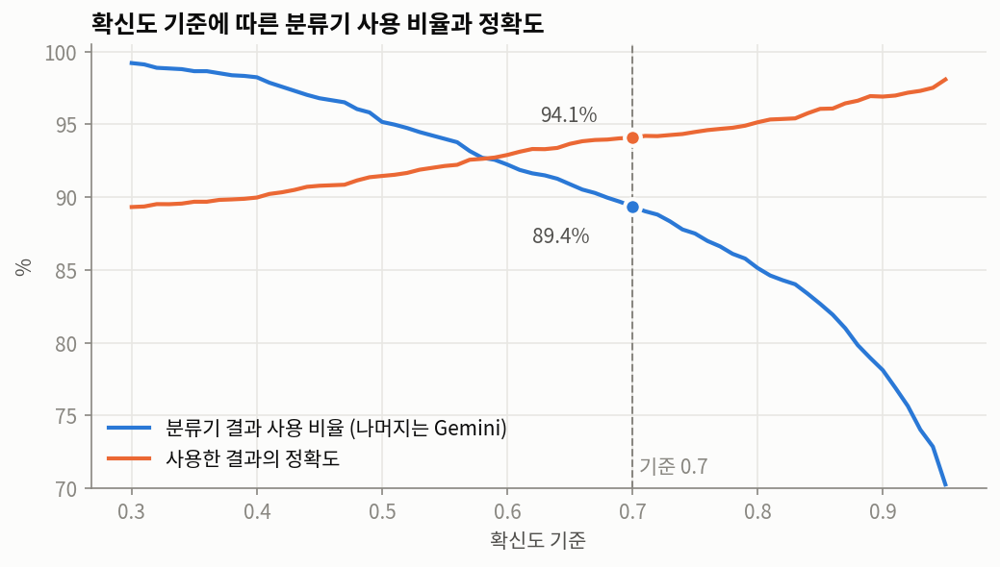

| 확신도 기준 | 분류기 결과 사용 | 그중 정확도 | Gemini 로 |
|---|---|---|---|
| 0.5 | 95.2% | 91.5% | 4.8% |
| 0.6 | 92.2% | 92.9% | 7.8% |
| **0.7 (기본)** | **89.4%** | **94.1%** | **10.6%** |
| 0.8 | 85.1% | 95.1% | 14.9% |
| 0.9 | 78.1% | 96.9% | 21.9% |

기준을 올리면 분류기 결과의 정확도는 오르지만 Gemini 호출이 늘어난다. 무료 등급 한도(분당 15회)를 생각하면
Gemini 로 가는 비율도 비용이다.

### 4.2 확신도 보정

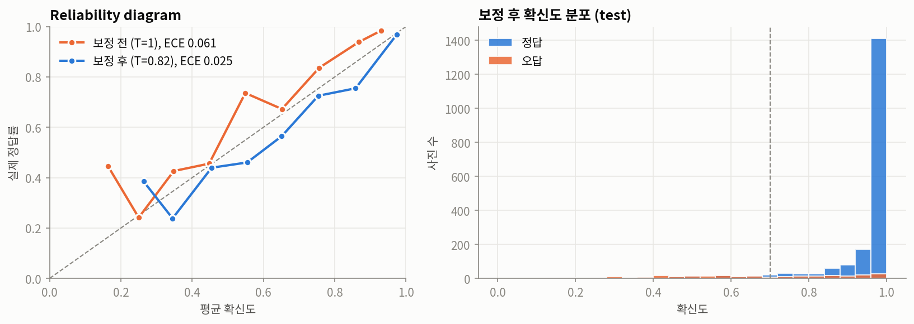

보정 전(T=1)에는 모델이 실제보다 자신 없게 예측했다(ECE 0.061, label smoothing 영향). T=0.82 로 보정한 뒤
ECE 는 0.025 로 낮아졌다. 0.7 기준은 이 보정된 확신도에 적용된다.

### 4.3 음식별 정확도

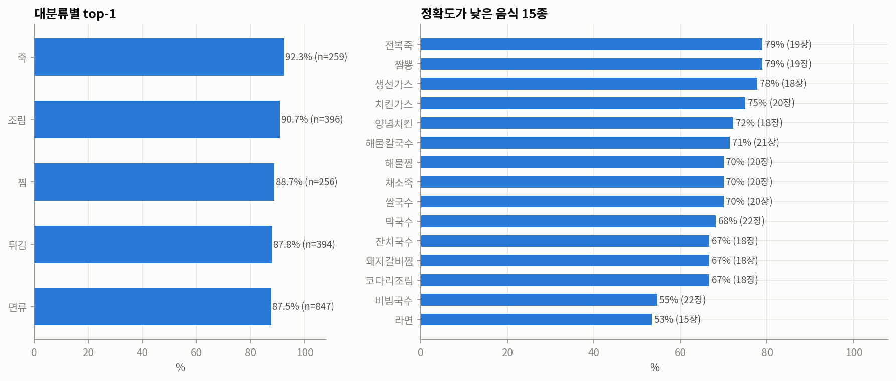

- 대분류: 죽 92.3%, 조림 90.7%, 찜 88.7%, 튀김 87.8%, 면류 87.5%.
- 109종 중 22종은 100%, 16종은 80% 미만. 가장 약한 음식은 라면 53%, 비빔국수 55%, 코다리조림·잔치국수·돼지갈비찜 67%.
- 자주 헷갈리는 쌍은 모양이 비슷한 같은 계열 음식이다.

| 정답 | 예측 | 오답 수 |
|---|---|---|
| 비빔국수 | 쫄면 | 6 |
| 막국수 | 물냉면 | 4 |
| 라면 | 짬뽕라면 | 4 |
| 메밀국수 | 막국수 | 3 |
| 만둣국 | 떡만둣국 | 3 |
| 닭튀김 | 탕수육 | 3 |
| 돼지갈비찜 | 소갈비찜 | 3 |
| 코다리조림 | 고등어조림 | 3 |

### 4.4 분류기가 모르는 음식 (test_dataset_296)

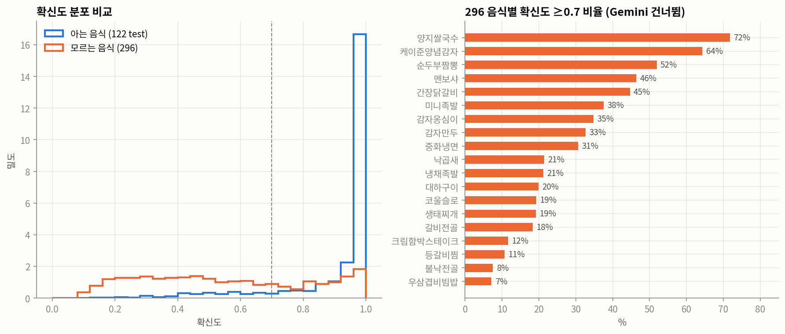

`test_dataset_296` 의 19종은 **하나도** 분류기 109종에 없다. 그런데 2,664장 중 **31.9%(851장)** 가
확신도 0.7 이상이었다(아는 음식 test 는 89.4%).

| 실제 음식(296) | 분류기 예측 | 장수 | 성격 |
|---|---|---|---|
| 양지쌀국수 | 쌀국수 | 151 | 상위 범주 (영양 비슷) |
| 케이준양념감자 | 감자튀김 | 63 | 상위 범주 |
| 멘보샤 | 두부고추장조림 | 35 | 오답 |
| 중화냉면 | 굴짬뽕 | 35 | 오답 |
| 순두부짬뽕 | 토마토스프 | 32 | 오답 |
| 간장닭갈비 | 깐풍기 | 25 | 오답 |
| 미니족발 | 족발 | 24 | 상위 범주 |
| 감자만두 | 고기만두 | 22 | 비슷한 음식 |

분포 밖 사진을 걸러내는 장치가 없어서, 틀린 음식명이 Gemini 를 거치지 않고 재료 예측과 영양 예측까지 그대로 간다.

### 4.5 예측 예시

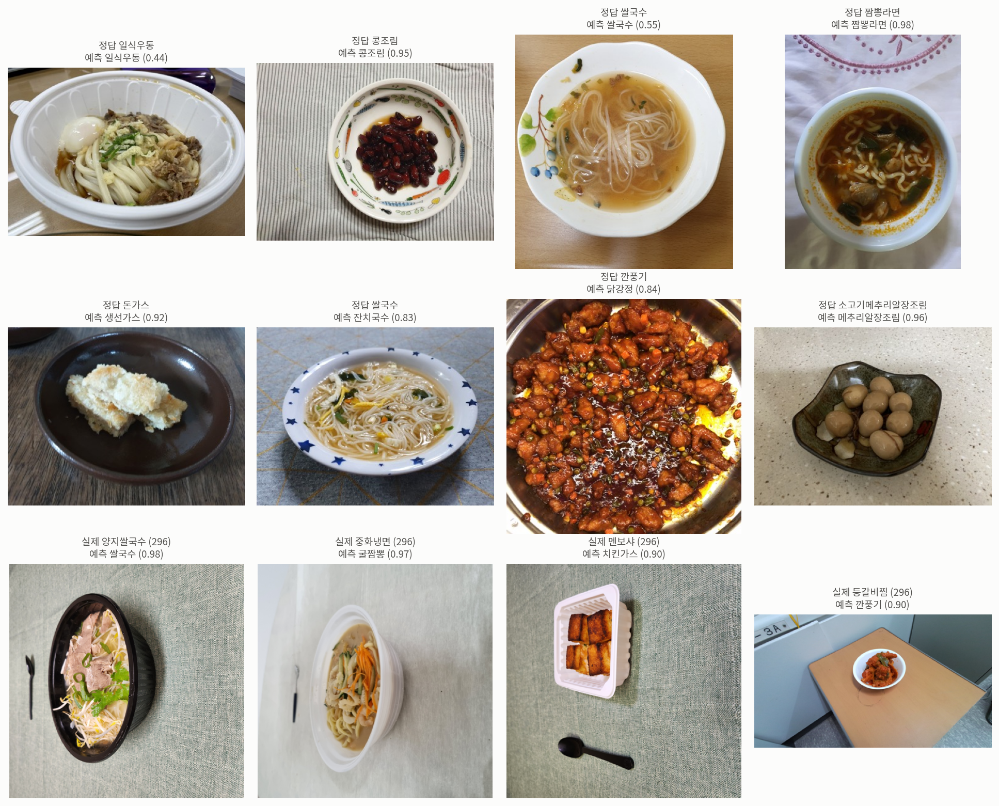

위: 맞힌 사진 / 가운데: 확신도가 높은데 틀린 사진 / 아래: 모르는 음식(296)인데 확신도 0.7 이상.

## 5. 파이프라인 (`n296/pipeline_infer.py`)

```
이미지 ─ 음식 분류기 ─ 확신도 ≥ 0.7 → 음식명
                   └ 확신도 < 0.7 → Gemini(gemini-3.5-flash-lite)가 음식명 예측
       ─ Gemini: 사진 + 음식명 → 재료
       ─ "{food_name} (재료: {ingredients})" → Gemini 임베딩 ─┐
       ─ 이미지 → ConvNeXt + 주파수 인코더 ────────────────────┴→ 영양성분 (calories, mass, fat, carb, protein)
```

- Gemini 결과는 `pipeline_raw.jsonl` 에 한 장씩 저장하고, 다시 실행하면 재사용한다(한도 절약). 일일 한도에 걸리면 저장 후 멈춘다.
- 동작 확인 (`runs/pipeline_smoke2`):

| 이미지 | 분류기 | 확신도 | 음식명 출처 | 최종 음식명 | 재료 |
|---|---|---|---|---|---|
| 122 test 돈가스 | 돈가스 | 0.69 | Gemini | 돈가스 | 돼지고기, 밀가루, 달걀, 빵가루, 식용유 |
| 296 대하구이 | 꽁치조림 | 0.23 | Gemini | 새우구이 | 새우, 소금 |

처음에는 원본 체크포인트(`model_stage3_296_final.pth`, `target_stats` 없음)로 돌려 칼로리가 약 2 로 나왔다.
새 영양 모델(10절)로 바꾼 뒤 돈가스 603 kcal (영양DB 621 kcal), 새우구이 151 kcal 로 나온다.

## 6. 작업 중 있었던 문제

| 문제 | 영향 | 조치 |
|---|---|---|
| mergerfs 여유 공간 규칙(하위 디스크 250G 미만이면 새 파일 생성 거부)에 압축 해제가 걸릴 뻔함 | 서버 전체 새 파일 생성이 막힐 수 있었음 | 압축 해제 중단, 깨진 zip·중복 zip 삭제, 하위 디스크 경로에 직접 해제 |
| Gemini 파이프라인이 요청 타임아웃 없이 멈춤 | 3.5-flash-lite 예측이 6분 정지 | `--timeout`(기본 90초) 추가 |
| 일일 한도에 걸린 뒤 프로세스가 종료되지 않음 | 3.8-flash 실행이 멈춘 채 남음 | 취소 방식 수정 (`as_completed` 와 `cancel_futures` 충돌) |
| 스모크 테스트에서 빈 이미지 경로가 현재 폴더로 해석됨 | Gemini 약 61회 낭비(54장) | 빈 경로·없는 경로는 즉시 중단 |
| split.csv 음식 코드를 정수로 읽음 | 코드 앞자리 0 누락(표시만) | `dtype=str`, 기존 체크포인트는 로드 시 8자리 복원 |
| AIHub API 키가 `aihubshell` 의 curl 인자로 프로세스 목록에 노출 | 공용 서버 사용자와 대화 기록에 키 노출 | **키 재발급 권장** |

## 7. 한계와 다음 단계

1. **분포 밖(OOD) 사진 처리.** 확신도 기준만으로는 모르는 음식을 걸러내지 못한다(4.4). 선택지:
   기준 상향(0.9 에서도 아는 음식 21.9% 가 Gemini 로), energy score·Mahalanobis 같은 OOD 점수 추가,
   "기타" 클래스 학습, 분류기 음식 종류 확대(다른 대분류 VAL zip 추가).
2. **영양 모델의 양 추정.** 새 영양 모델(10절)은 모든 사진을 1인분으로 가정해 학습했다. 사진 속 양을 배우려면
   AIHub 122 양추정 이미지(48GB, Q1~Q5)로 학습해야 한다 (`configs/aihub122.yaml` + 같은 재료 텍스트).
3. **학습 데이터 편향.** 분류기는 Validation 이미지만으로 학습했다(1종당 약 200장). Training zip 까지 쓰면 종류당
   약 1,600장이지만 zip 하나가 20~30GB 이고 8종 정도만 담고 있다.
4. **평가 누수 가능성.** 같은 음식을 다른 시각에 찍은 사진이 train/test 에 함께 있을 수 있다(2장).

## 8. 파일

| 경로 | 내용 |
|---|---|
| `n296/build_manifest_cls109.py` | 109종 사진 + 영양DB → 영양 모델 manifest, 재료 생성(Gemini) |
| `configs/cls109_nutrition.yaml` | 새 영양 모델 config (텍스트 "음식명 (재료: …)") |
| `runs/nutrition_cls109/model_stage3_296_final.pth` | 새 영양 모델 (`target_stats` 포함, 파이프라인 기본) |
| `runs/nutrition_cls109/eval_*.csv`, `history.csv` | 테스트 예측, 학습 이력 |
| `notebooks/nutrition_cls109_results.ipynb` | 영양 모델 결과 시각화 |
| `data/food_ingredients_122.json` | 영양DB 400종 재료 (Gemini 생성) |
| `n296/food_classifier.py` | 분류기 데이터 준비(`prepare`), 학습(`train`), 추론(`FoodClassifier`) |
| `n296/pipeline_infer.py` | 이미지 → 분류기/Gemini 음식명 → Gemini 재료 → 임베딩 → 영양 예측 |
| `n296/predict_food_gemini.py` | Gemini 음식명·재료 일괄 예측, 공통 호출 함수 `gemini_json` |
| `n296/build_manifest_122.py` | `classification_code2name` (음식 코드 → 음식명) |
| `notebooks/food_classifier_results.ipynb` | 결과 시각화 노트북 (커널 `Python (diet)`) |
| `runs/food_cls_122/best.pth` | 분류기 체크포인트 (temperature 포함) |
| `runs/food_cls_122/report.json` | val/test 지표, 기준별 결과, 학습 이력 |
| `runs/food_cls_122/test_per_class.csv` | 음식별 test 정확도 |
| `runs/food_cls_122/ood_test296.csv` | 296 사진별 분류기 예측·확신도 |
| `runs/food_cls_122/figures/` | 노트북 그림 PNG |
| `data/food_cls_122/` | 384px 사본 이미지와 `split.csv` |
| `datasets/aihub_122/val_images_109cls/images/` | 원본 이미지 (109종, 21,539장, 약 48GB) |

`runs/`, `data/` 는 `/mnt/nvme2/...` 하위 디스크에 저장되며 `/home` 경로에서도 보인다(README "디스크" 참고).

## 9. 재현

```bash
cd /home/students/cs/202321024/2025_2/diet-management/n296_stage3
conda activate diet
python -m n296.food_classifier prepare --config configs/aihub122.yaml \
    --images-root /home/students/cs/202321024/datasets/aihub_122/val_images_109cls/images
CUDA_VISIBLE_DEVICES=3 python -m n296.food_classifier train --config configs/aihub122.yaml
jupyter nbconvert --to notebook --execute --inplace --ExecutePreprocessor.kernel_name=diet \
    notebooks/food_classifier_results.ipynb
# 영양 모델
python -m n296.build_manifest_cls109 --config configs/cls109_nutrition.yaml   # 재료 생성(Gemini) + manifest
GEMINI_KEY=... python -m n296.embeddings --config configs/cls109_nutrition.yaml --manifest \
    data/manifest_cls109.csv data/manifest_cls109_db.csv data/manifest_cls109_test_seen.csv data/manifest_cls109_test_unseen.csv
CUDA_VISIBLE_DEVICES=3 python -m n296.train --config configs/cls109_nutrition.yaml
python -m n296.evaluate --config configs/cls109_nutrition.yaml --ckpt runs/nutrition_cls109/model_stage3_296_final.pth \
    --manifest data/manifest_cls109_test_unseen.csv --out runs/nutrition_cls109/eval_test_unseen_full.csv
# 파이프라인
CUDA_VISIBLE_DEVICES=0 python -m n296.pipeline_infer --config configs/cls109_nutrition.yaml \
    --nutrition-ckpt runs/nutrition_cls109/model_stage3_296_final.pth \
    --images <이미지 또는 폴더> --out-dir runs/<이름>
```

## 10. 영양 모델 재학습 (`configs/cls109_nutrition.yaml`)

### 데이터와 설정

- 사진: 분류기와 같은 109종 사진(384px 사본). **정답 = 영양DB 1인분(Q4) 값** — 양 정보가 없어 같은 음식의 사진은 정답이 같다.
- 텍스트: `"{food_name} (재료: {ingredients})"`. 재료는 영양DB 400종마다 Gemini(3.5-flash-lite)에 음식명만 주고 생성
  (50종씩 8회 호출, `data/food_ingredients_122.json`). 예: `돈가스 (재료: 돼지고기, 밀가루, 달걀, 빵가루, 식용유, 소금, 후추)`.
  파이프라인은 사진 + 음식명으로 재료를 받으므로 표현이 조금 다를 수 있다.
- 분할: 대분류마다 음식을 떼어 둔다 (`n296/build_manifest_cls109.py`).

| 구분 | 음식 | 사진 | 용도 |
|---|---|---|---|
| train | 83종 | 14,754 | 학습 (+ 텍스트 전용 영양DB 374종) |
| val | 10종 | 2,014 | 조기 종료 기준 — **처음 보는 음식** |
| test_seen | 83종 | 1,641 | 학습한 음식의 다른 사진 |
| test_unseen | 16종 | 3,130 | **처음 보는 음식** |

- 모델·학습: 기존 Stage3 구조 그대로 (텍스트 → 이미지 → 결합 3단계, 조기 종료 patience 10). GPU L4 1장, 약 75분.
  단계별 best 검증 mean PMAE: 텍스트 26.9 → 이미지 26.5 → 결합 26.5 (epoch 9).

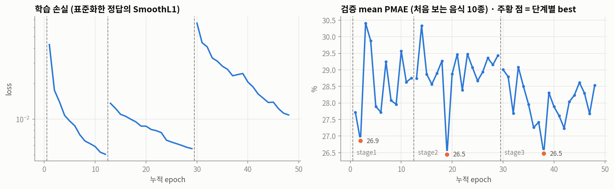

### 결과

mean PMAE = 칼로리·지방·단백질 PMAE 평균 (PMAE = 100 × MAE / 정답 평균).

| test | 입력 | 칼로리 | 지방 | 단백질 | 중량 | 탄수화물 | **mean PMAE** |
|---|---|---|---|---|---|---|---|
| test_seen | 평균값 예측 (기준선) | 44.9 | 67.4 | 57.3 | 67.8 | 63.1 | 56.6 |
| | 텍스트만 | 2.2 | 3.4 | 2.2 | 2.7 | 3.1 | **2.6** |
| | 텍스트 + 이미지 | 2.9 | 4.5 | 4.0 | 4.0 | 3.9 | 3.8 |
| test_unseen | 평균값 예측 (기준선) | 42.3 | 63.2 | 39.1 | 61.0 | 79.9 | 48.2 |
| | 텍스트만 | 42.1 | 60.4 | 40.8 | 19.6 | 46.1 | 47.8 |
| | 텍스트 + 이미지 | 39.4 | 53.9 | 37.9 | 18.9 | 47.1 | **43.8** |

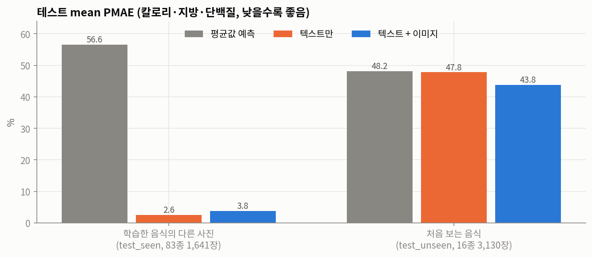

- **학습한 음식**은 거의 정확하다(3.8%). 하지만 음식마다 정답이 하나라 "음식 → 1인분 영양값"을 외운 것이고,
  사진 속 양을 읽는 능력은 평가되지 않는다. 이미지를 더하면 오히려 조금 나빠진다(2.6 → 3.8%).
- **처음 보는 음식**은 43.8% 로, 평균값만 예측하는 기준선(48.2%)보다 조금 낫다. 이미지는 도움이 된다(47.8 → 43.8%).
  음식명·재료 텍스트만으로 새 음식의 영양값을 추론하는 능력은 거의 없다.
- 처음 보는 음식의 사진별 예측은 거의 같다(음식 안 표준편차 평균 10 kcal). 모델이 사진보다 텍스트에 기대고 있다.

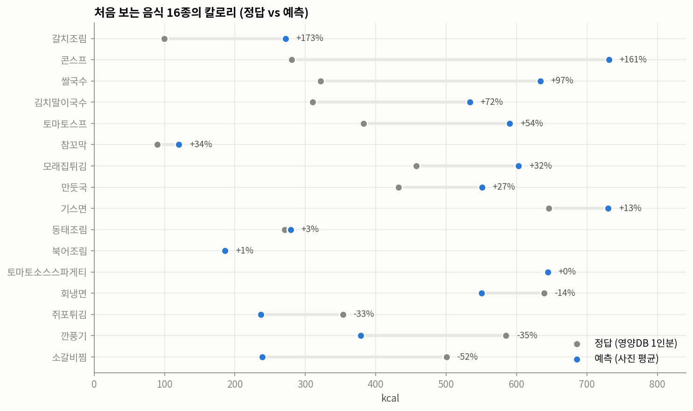

- 크게 틀린 음식: 갈치조림 +173%, 콘스프 +161%, 쌀국수 +97%, 소갈비찜 −52%.
  영양DB 의 1인분 중량이 음식마다 제각각이라(갈치조림 100g, 기스면 1,000g) 이름만으로는 1인분 크기를 알기 어렵다.
  중량 오차(18.9%)는 칼로리 오차(39.4%)보다 작다.

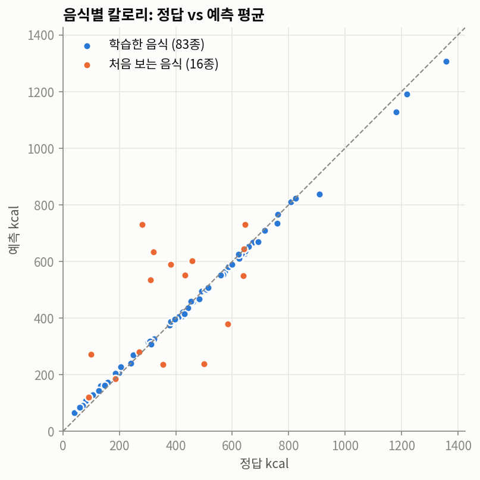

### 파이프라인에 미치는 영향

- 분류기가 확신하는 음식(109종 안): 영양값은 영양DB 1인분에 가깝게 나온다.
- Gemini 로 넘어간 음식(대부분 109종 밖): 영양값 오차가 크다(처음 보는 음식 기준 칼로리 PMAE 약 40%).
- 개선 방향: (1) 양추정 이미지로 학습해 사진 속 양 반영, (2) 처음 보는 음식은 영양DB 에서 비슷한 음식을 찾아
  (Gemini 임베딩 최근접) 그 값을 쓰는 검색 방식과 비교, (3) 학습 음식 종류 확대.

## 11. 파이프라인 전체 평가 (`n296/eval_pipeline.py`)

이미지 → 분류기(확신도 < 0.7 이면 Gemini) 음식명 → Gemini 재료 → 새 영양 모델, 전체 과정을 테스트 사진으로 평가했다.
Gemini 무료 등급 한도 때문에 표본만 썼다 (Gemini 호출 약 220회).
결과: `runs/pipeline_eval/` (`results.csv`, `summary.json`), 시각화: [`notebooks/pipeline_eval_results.ipynb`](notebooks/pipeline_eval_results.ipynb).

| 세트 | 사진 | 내용 | 정답 |
|---|---|---|---|
| aihub122 | 109 (109종 × 1) | 분류기 test 분할, 분류기가 **아는** 음식 | 영양DB 1인분 |
| test296 | 57 (19종 × 3) | test_dataset_296, 분류기가 **모르는** 음식 | 296 라벨 1인분 |

oracle = 정답 음식명 + 영양DB 재료를 넣은 같은 영양 모델 (aihub122 만 가능). pipeline − oracle = 인식(음식명·재료) 오차.

### 요약

| 세트 | Gemini 로 | 음식명 정확도 | 칼로리 PMAE | mean PMAE (pipeline) | mean PMAE (oracle) |
|---|---|---|---|---|---|
| aihub122 | 14.7% | 78.0% | 15.8 | **20.6** | 11.4 |
| test296 | 71.9% | (이름 불일치) | 44.7 | **51.0** | — |

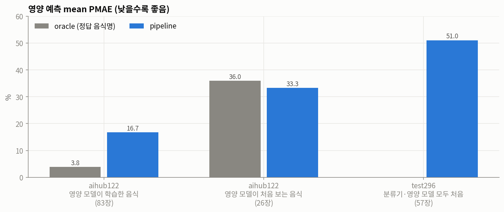

| aihub122 세부 | 사진 | pipeline | oracle |
|---|---|---|---|
| 영양 모델이 학습한 음식 | 83 | 16.7 | 3.8 |
| 영양 모델이 처음 보는 음식 | 26 | 33.3 | 36.0 |
| 음식명 정답 | 85 | 15.3 | 11.7 |
| 음식명 오답 | 24 | 45.8 | 10.3 |

### 발견

1. **음식명이 틀리면 영양 오차가 3배로 커진다** (mean PMAE 15.3 → 45.8, 칼로리 절대오차 중앙값 6% → 20%).
   예: 소고기메추리알장조림 → "소곱창전골"(61 → 562 kcal), 물만두 → 고기만두, 양념치킨 → 북어조림.
2. **Gemini 폴백이 아는 음식에서는 오히려 손해다.** aihub122 에서 Gemini 로 넘어간 16장 중 분류기 top1 이 맞았던 것이
   8장인데, Gemini 는 2장만 맞혔다 (자유롭게 이름을 지어 "생선조림", "버섯 칼국수", "죽" 처럼 영양DB 에 없는 이름을 낸다).
   분류기 top1 만 쓰면 음식명 정확도가 83.5%, 폴백을 거치면 78.0%.
   → Gemini 에게 분류기 top-5 또는 영양DB 음식 목록 중에서 고르게 하면 나아질 가능성이 크다.
3. **분류기가 확신하고 틀린 경우**도 10장(9%) 있다: 탕수육 → 닭튀김(0.96), 라면 → 짬뽕라면(1.00), 물만두 → 고기만두(0.99).
4. **재료 텍스트 차이.** 음식명이 맞아도 pipeline(15.3) 이 oracle(11.7) 보다 나쁘다. 파이프라인은 사진을 보고 Gemini 가 낸
   재료를, 학습은 음식명만 보고 낸 재료를 쓰기 때문이다. 학습한 음식에서 차이가 특히 크다(3.8 → 16.7).
5. **test296(분류기·영양 모델 모두 처음)** 은 mean PMAE 51.0 으로 평균값 예측 수준이다. 57장 중 16장은 분류기가
   확신(≥0.7)해 Gemini 를 거치지 않았다 (순두부짬뽕 → 토마토스프, 케이준양념감자 → 감자튀김 등).
   정답이 296 라벨이라 영양DB 와 1인분 기준이 다르다는 점도 오차에 섞여 있다.

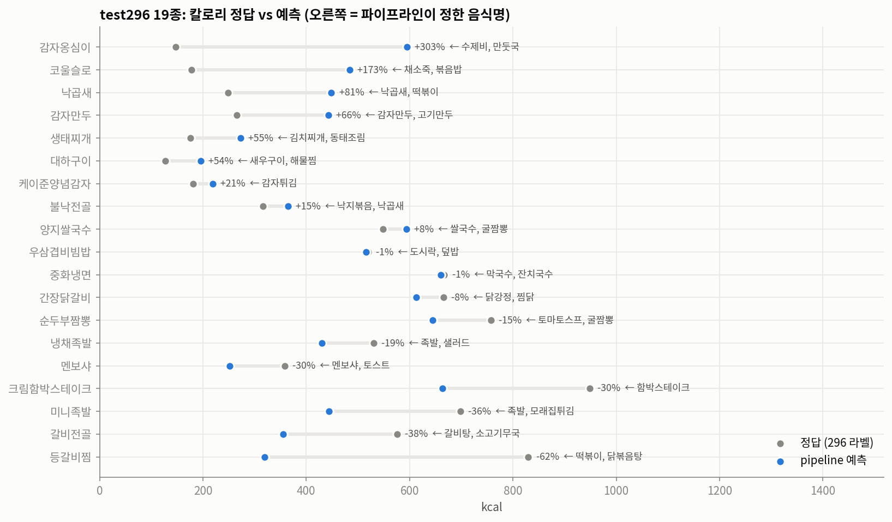

### 개선 우선순위

1. Gemini 폴백을 **분류기 top-5 / 영양DB 음식 목록 중 선택**으로 제한 (발견 2)
2. 학습 텍스트의 재료를 파이프라인과 같은 방식(사진 + 음식명 → Gemini)으로 만들거나, 추론 때 재료를 영양DB 재료로 통일 (발견 4)
3. 분포 밖 사진 검출 또는 확신도 기준 조정 (발견 3, 5)
4. 영양DB 에 없는 음식은 임베딩 최근접 영양DB 음식 값으로 대체하는 검색 방식과 비교
