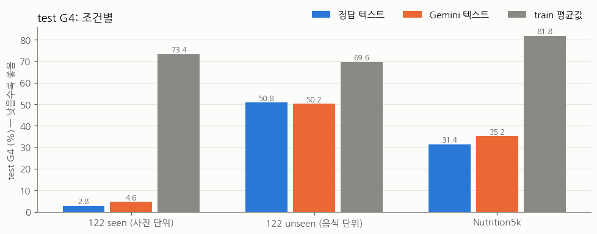
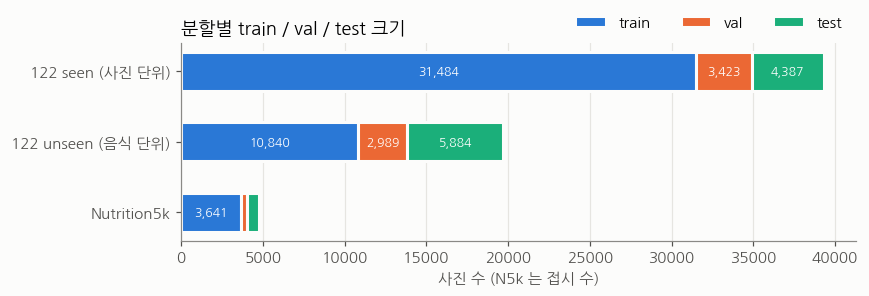
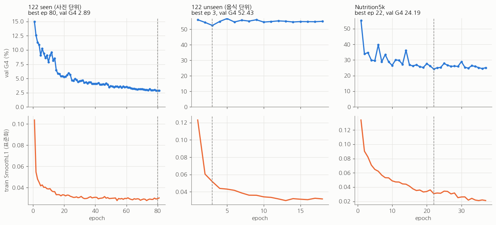
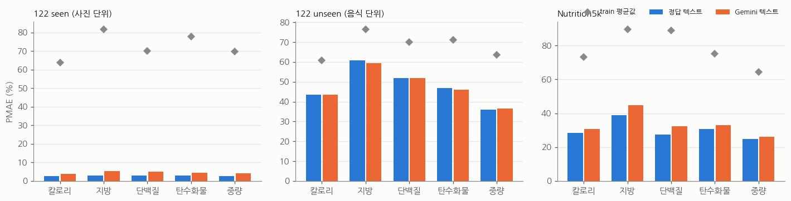
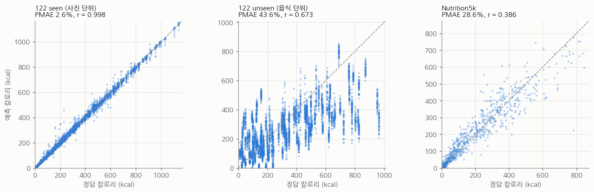
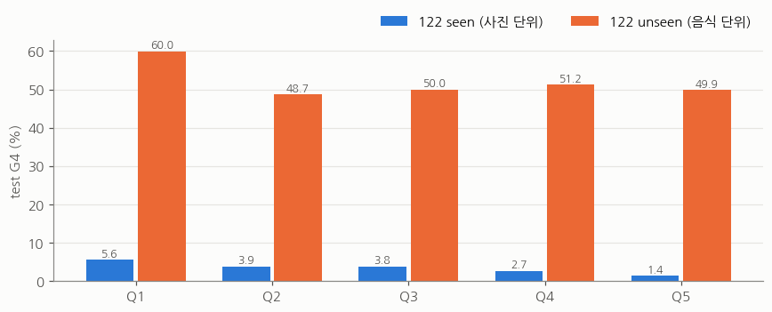
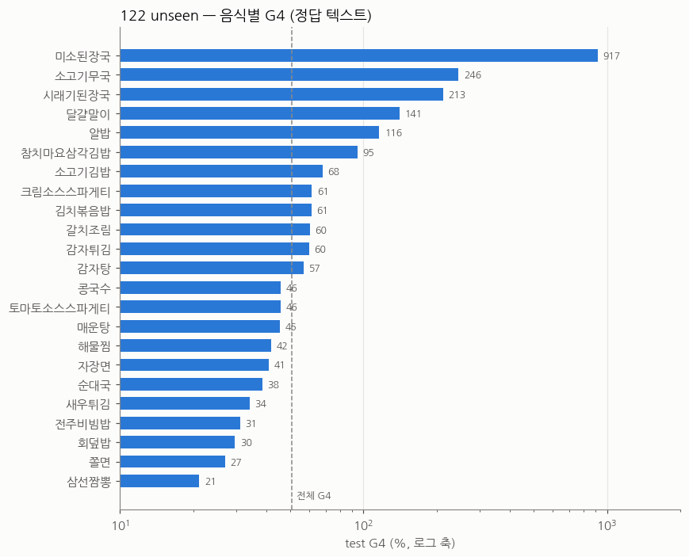
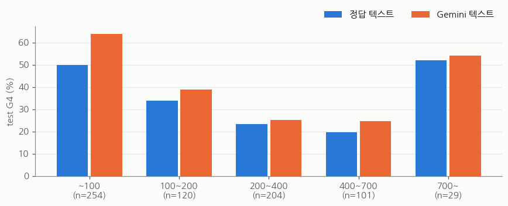
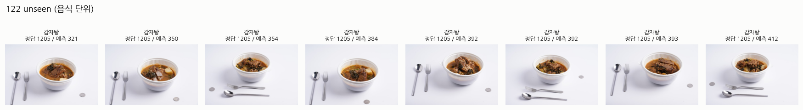

# n296_stage3_3 영양 모델 — food_split_txt 3개 분할 학습 보고서

- 작성: 2026-11-01 · 위치: `/home/leehogwang/food_b/experiments/split_txt_3runs/`
- 코드: `/home/leehogwang/food_b` (`leehogwang/diet-management`, 브랜치 `n296_stage3_3`, 커밋 `5223d35`)
- 분할: `/home/leehogwang/food_split_txt/{122_1_forseen, 122_2_forunseen, n5k}`
- 시각화 노트북: [`results.ipynb`](results.ipynb) (실행된 상태로 저장) · 그림: [`figures/`](figures/)

---

## 0. 요약

| 분할 | 무엇을 보는가 | test | **test G4 (정답 텍스트)** | test G4 (Gemini 텍스트) | 평균값 예측 |
|---|---|---|---|---|---|
| **122_1_forseen** | 학습한 음식 78종, 처음 보는 사진 | 4,387장 | **2.82** | 4.63 | 73.36 |
| **122_2_forunseen** | 처음 보는 음식 23종 | 5,884장 | **50.77** | 50.25 | 69.63 |
| **n5k** | Nutrition5k 서양식 접시 | 708접시 | **31.39** | 35.23 | 81.78 |

G4 = 칼로리·지방·단백질·탄수화물 PMAE(Σ|예측−정답| ÷ Σ정답 × 100)의 평균 (%). 낮을수록 좋다.

- **학습한 음식이면 거의 정확하다 (G4 2.8%).** 음식명과 양 등급(Q1~Q5)을 둘 다 맞혀야 나오는 수치다. Gemini 가 음식명을 추정해도 4.6% 다.
- **처음 보는 음식이면 크게 떨어진다 (G4 50.8%).** 평균값 예측(69.6%)보다는 낫지만 검증 성능이 3 epoch 이후 나아지지 않았다. 국물 요리(미소된장국·소고기무국 등)를 2~8배 과대 예측한 것이 큰 몫이다.
- **Nutrition5k 는 31.4%** 다. 하지만 이 중 상당 부분이 **라벨 오류로 보이는 2접시** 때문이다. 둘 다 약 9,500 kcal, 지방 850 g 이상으로 기록돼 있다. 이 2접시를 빼면 **24.7%** 다(Gemini 텍스트 29.0%).
  위쪽 사진(overhead)만 보면 22.7%, 측면 영상 프레임 접시는 53.4% 다. 위 2접시도 측면 프레임 접시다.



---

## 1. 무엇을 학습했나

### 1.1 모델

n296_stage3_3 의 **영양 모델** `n296.model.Stage3NutritionModel` (파이프라인 4-1 단계)을 분할마다 처음부터(ImageNet 사전학습 가중치에서) 따로 학습했다.

| 구성 | 내용 |
|---|---|
| 텍스트 분기 | Gemini 임베딩(`gemini-embedding-2`, 3072차원) → MLP 512 → 512 |
| 이미지 분기 | ConvNeXt-Base (ImageNet), 1024차원. stem~stage2 고정 |
| 주파수 분기 | ConvNeXt features[5] 특징의 FFT 대역 통과(Tukey window) + VGG16 분기 → Mixer |
| 헤드 | 칼로리·중량·지방·탄수화물·단백질 5개 회귀 (표준화 공간) |
| 설정 | `configs/aihub122.yaml` 그대로 (dropout 0.3, modality dropout 0.3) |
| 학습 파라미터 | 112.9M |

**학습 대상을 영양 모델로 정한 이유.** 세 분할에 공통으로 있는 정답은 영양값(칼로리·지방·단백질·탄수화물·중량)뿐이다.
양추정 모델(`QuantityNet`, Q1~Q5)은 122 에만 정답이 있고 Nutrition5k 에는 없다. 음식 분류기(109종)도 Nutrition5k 에는 정답 클래스가 없다.
그래서 세 분할 모두에서 같은 조건으로 비교할 수 있는 영양 모델을 학습했다.
122 의 정답은 이미 "영양DB 1인분 × Q 비율" 이라서, 이 모델이 양 차이까지 사진에서 직접 배워야 한다.

### 1.2 학습 설정 (세 런 공통)

| 항목 | 값 |
|---|---|
| 손실 | 표준화 타깃(train 평균·표준편차) SmoothL1 |
| 최적화 | AdamW lr 3e-4, weight decay 1e-4, batch 64, grad clip 5, bf16 autocast |
| 스케줄 | ReduceLROnPlateau (factor 0.5, patience 3, 검증 G4 기준) |
| 입력 | 224px. 학습: RandomResizedCrop(0.7~1) + 좌우 반전 + ColorJitter / 평가: 256 resize → 224 center crop |
| 조기 종료 | 검증 G4 최저 체크포인트, patience 15 epoch |
| 시간 상한 | 122_1_forseen 180분, 나머지 150분 |
| 시드 | 42 |
| 학습 텍스트 | **정답 텍스트**: 122 = 음식명, N5k = 재료 목록(접시마다 고정 시드로 순서 섞음) |
| GPU | RTX A6000. GPU0 = 122_1_forseen, GPU1 = 122_2_forunseen·n5k 동시 |

이 루프는 실험 40(`Food-Nutrition-Estimation/experiments/40_unified`)의 3번 모델 하네스와 같다. 다른 점은 다음 세 가지다.
- 분할을 `food_split_txt` 로 바꿨다.
- 시간 상한을 늘렸다 (실험 40 은 100분).
- autocast 를 fp16 에서 bf16 으로 바꿨다.

### 1.3 test 조건

| 조건 | 텍스트 입력 | 뜻 |
|---|---|---|
| `text_gt` | 정답 음식명 / 정답 재료 목록 | 인식 단계가 완벽할 때의 상한 |
| `text_gemini` | `gemini-3.8-flash` 가 사진만 보고 추정한 음식명(122) / 재료 목록(N5k) | 실제 사용에 가까운 조건 |
| `baseline` | — | train 평균값을 모든 사진에 예측 |

Gemini 추정은 실험 40 에서 이미 만든 7,875장을 재사용했다. 없던 2,484장(122 위쪽 사진, N5k 측면 접시 등)만 같은 모델·프롬프트로 새로 호출했다. 토큰은 입력 284만, 출력 2.9만이다.
세 test 세트 모두 텍스트가 빠진 사진은 없다.

---

## 2. 데이터



| 분할 | train | val | test | 음식 수 (train / val / test) | 촬영 시점 |
|---|---|---|---|---|---|
| 122_1_forseen | 31,484 | 3,423 | 4,387 | 78 / 78 / 78 | side·top 반반 |
| 122_2_forunseen | 10,840 | 2,989 | 5,884 | 44 / 12 / 23 | side 만 |
| n5k | 3,641 | 405 | 708 | — | overhead 3,260 · 측면 프레임 1,494 |

### 2.1 AIHub 122 (양추정 사진)

- 정답은 영양DB 1인분 값 × Q 비율(Q1 0.25 · Q2 0.5 · Q3 0.75 · Q4 1.0 · Q5 1.25)이다.
- 사진은 512px 사본을 썼다. 측면 사진은 `/mnt/data/food_leehogwang/unified40/img`, 위쪽 사진은 `shared_models/m3_122/n296_stage3_3/data/quantity_122/img` 에 있다.
- 정답과 음식명은 실험 40 `records.json`(측면 19,713장)과 `food_b/data/manifest_122.csv`(39,294장)에서 가져왔다. 겹치는 사진에서 두 출처의 칼로리 차이는 최대 2.4e-5 kcal 로 사실상 같다.
- 음식명 텍스트는 실험 40 의 정규화 이름(예: 물회 → 생선물회)을 썼다. 실험 40 에 없던 `기타잡곡밥`(오곡밥)만 manifest 이름 그대로 쓰고 새로 임베딩했다.
- **122_1_forseen 의 val·test 구성.** val 은 공식 Training 에서 (음식, Q) 묶음마다 10% 를 뺐다. test 는 공식 Validation 이다.
  - 같은 번호의 side/top 사진(예: `side_…_꽃게탕_Q1_00002` 와 `top_…_Q1_00002`)이 train 과 test 에 나뉘어 들어간 경우가 3,196쌍 있다.
  - 같은 번호가 같은 접시라면 test 가 다소 낙관적일 수 있다. 원본 라벨로 확인하지 않았다.
- **122_2_forunseen.** test 음식 23종(파일명 기준 24종이다. `감자튀김(스틱형)` 과 `(웨지감자)` 는 정답 음식명 `감자튀김` 하나로 합쳐진다)은 train·val 에 없다.
  `오므라이스` 만 train(사각배달 용기)과 val(접시)에 함께 있다.

### 2.2 Nutrition5k

- 분할은 `rgb_train_ids.txt`(4,059) / `rgb_test_ids.txt`(709) 이고, 정답은 접시 전체의 실제 측정값(`dish_metadata_cafe{1,2}.csv`)이다.
- 사진은 realsense overhead `rgb.png` 를 우선 썼다. 없으면 측면 영상 프레임(`frames_sampled5/camera_A_frame_010.jpeg`, 없으면 camera_B~D)을 썼다.
  - rgb 분할의 약 30% 는 overhead 사진이 없다. 그래서 위쪽 사진과 측면 사진이 섞인다.
- 사진이 하나도 없는 12접시와 칼로리 0 인 2접시를 뺐다. 그래서 train+val 이 4,046, test 가 708 이다.
- 분할 파일에 val 이 없다. 그래서 train 의 10% 를 촬영 시각 60초 이내 접시끼리 묶어 무작위로 뽑았다(seed 42, 실험 40 과 같은 방식).

---

## 3. 학습 과정



| 분할 | best epoch / 실행 epoch | 종료 이유 | 시간 | val G4 |
|---|---|---|---|---|
| 122_1_forseen | 80 / 81 | **시간 상한(180분)** | 180.2분 | 2.89 |
| 122_2_forunseen | 3 / 18 | 조기 종료 | 26.5분 | 52.43 |
| n5k | 22 / 37 | 조기 종료 | 23.3분 | 24.19 |

- **122_1_forseen** 은 끝까지 천천히 좋아졌다. 학습률은 9.4e-6 까지 내려갔다. 시간 상한에 걸렸으니 더 돌리면 조금 더 낮아질 수 있다.
  첫 epoch 는 디스크 캐시 때문에 275초였고, 이후는 epoch 당 약 130초다.
- **122_2_forunseen** 은 train 손실이 계속 내려가는데 검증 G4 는 첫 epoch(56)부터 52~57 사이에서 멈췄다. 학습 음식에 과적합하고 처음 보는 음식으로는 일반화하지 못하는 전형적인 모양이다.
- **n5k** 는 검증 G4 가 크게 흔들렸다(val 405접시). 22 epoch 에서 24.2 가 가장 낮았다.

---

## 4. test 결과

### 4.1 전체

| 분할 | 조건 | n | G4 | A4 | 칼로리 | 지방 | 단백질 | 탄수화물 | 중량 | mean PMAE (칼·지·단) |
|---|---|---|---|---|---|---|---|---|---|---|
| 122_1_forseen | 정답 텍스트 | 4,387 | **2.82** | 4.43 | 2.64 | 3.01 | 2.83 | 2.81 | 2.59 | 2.83 |
| | Gemini 텍스트 | 4,387 | 4.63 | 7.01 | 3.74 | 5.25 | 5.09 | 4.44 | 4.07 | 4.69 |
| | train 평균값 | 4,387 | 73.36 | 234.37 | 63.72 | 81.86 | 70.04 | 77.81 | 69.92 | 71.87 |
| 122_2_forunseen | 정답 텍스트 | 5,884 | **50.77** | 84.20 | 43.59 | 60.89 | 51.86 | 46.74 | 35.84 | 52.11 |
| | Gemini 텍스트 | 5,884 | 50.25 | 83.61 | 43.54 | 59.37 | 51.92 | 46.16 | 36.54 | 51.61 |
| | train 평균값 | 5,884 | 69.63 | 164.46 | 60.73 | 76.56 | 70.03 | 71.20 | 63.71 | 69.11 |
| n5k | 정답 텍스트 | 708 | **31.39** | 35.21 | 28.57 | 38.81 | 27.44 | 30.75 | 24.66 | 31.60 |
| | Gemini 텍스트 | 708 | 35.23 | 44.65 | 30.68 | 44.67 | 32.47 | 33.09 | 26.01 | 35.94 |
| | train 평균값 | 708 | 81.78 | 287.33 | 73.29 | 89.67 | 88.99 | 75.17 | 64.42 | 83.98 |

- 영양소별 PMAE 는 G(Σ|오차| ÷ Σ정답)다. **A4** 는 사진마다 |오차| ÷ (정답+1) 을 낸 뒤 평균한 값이라, 정답이 작은 사진에 민감하다.
- mean PMAE 는 n296 README 의 정의(칼로리·지방·단백질 평균)다.
- 정답 텍스트 기준 MAE (원 단위)

  | 분할 | 칼로리 (kcal) | 지방 (g) | 단백질 (g) | 탄수화물 (g) | 중량 (g) |
  |---|---|---|---|---|---|
  | 122_1_forseen | 8.6 | 0.35 | 0.46 | 1.06 | 7.3 |
  | 122_2_forunseen | 157.2 | 7.44 | 8.54 | 19.85 | 115.6 |
  | n5k | 72.4 | 5.31 | 4.38 | 5.86 | 47.4 |





칼로리 예측과 정답의 상관계수는 다음과 같다.
- 122 seen: r = 0.998
- 122 unseen: r = 0.673. 같은 음식 사진이 세로 띠를 이룬다. 음식마다 거의 같은 값을 예측하고, 그 값이 Q 등급에 따라 조금만 움직인다.
- N5k: r = 0.386. 정답 9,486 / 9,170 kcal 로 라벨된 2접시(`dish_1551567573`, `dish_1551567508`)가 축 밖에 있다. 모델은 이 둘을 569 / 54 kcal 로 예측했고, 이 2접시가 상관계수를 크게 낮춘다 (4.6절).

### 4.2 AIHub 122 — 양 등급별

| 분할 | Q1 | Q2 | Q3 | Q4 | Q5 |
|---|---|---|---|---|---|
| 122_1_forseen | 5.55 | 3.88 | 3.82 | 2.69 | 1.37 |
| 122_2_forunseen | 59.98 | 48.66 | 49.97 | 51.19 | 49.91 |



- seen 에서는 양이 적을수록 PMAE 가 크다. 정답이 작아 같은 절대 오차도 비율로는 커지기 때문이다. 그래도 Q1 도 5.6% 다. 사진에서 양 등급을 거의 정확히 읽는다는 뜻이다.
- unseen 에서는 등급과 상관없이 50% 안팎이다. 오차는 양보다 **음식 자체의 1인분 값을 모르는 데서** 온다.

### 4.3 122_1_forseen — 촬영 시점별

| 시점 | n | G4 정답 텍스트 | G4 Gemini 텍스트 |
|---|---|---|---|
| side | 2,138 | 3.08 | 5.03 |
| top | 2,249 | 2.59 | 4.26 |

위쪽 사진이 조금 더 정확하다. 위에서 보면 그릇 안의 양이 더 잘 보이기 때문으로 보인다.

### 4.4 122_2_forunseen — 음식별



| 구간 | 음식 (G4 %) |
|---|---|
| 잘 맞음 (< 35) | 삼선짬뽕 21 · 쫄면 27 · 회덮밥 30 · 전주비빔밥 31 · 새우튀김 34 |
| 중간 (35~70) | 순대국 38 · 자장면 41 · 해물찜 42 · 매운탕 45 · 토마토소스스파게티 46 · 콩국수 46 · 감자탕 57 · 감자튀김 60 · 갈치조림 60 · 김치볶음밥 61 · 크림소스스파게티 61 · 소고기김밥 68 |
| 크게 틀림 (> 90) | 참치마요삼각김밥 95 · 알밥 116 · 달걀말이 141 · 시래기된장국 213 · 소고기무국 246 · **미소된장국 917** |

크게 틀린 음식은 대부분 **정답 영양값이 작은데 학습 평균에 끌려 과대 예측한** 경우다 (정답 평균 → 예측 평균).

| 음식 | 칼로리 (kcal) | 탄수화물 (g) | 중량 (g) |
|---|---|---|---|
| 미소된장국 | 28 → 217 | 1.3 → 32.7 | 112 → 323 |
| 소고기무국 | 94 → 309 | 6.1 → 39.7 | |
| 시래기된장국 | 75 → 236 | 8.1 → 30.7 | |
| 알밥 | 지방 2.7 g → 12.4 g, 칼로리는 471 → 414 로 비슷함 | | |

train 평균은 칼로리 315 kcal, 중량 278 g 이다. G 는 정답 합으로 나누므로, 정답이 작은 국물 요리에서 몇 배로 커진다.
반대로 고칼로리 음식(감자탕 정답 최대 1,205 kcal → 예측 300~400)은 과소 예측한다. 처음 보는 음식에서 모델이 **train 평균 쪽으로 수축**한다는 뜻이다.

### 4.5 Gemini 음식명 추정 (122 test)

| 분할 | n | 음식명 글자 일치율 |
|---|---|---|
| 122_1_forseen | 4,387 | 55.3% |
| 122_2_forunseen | 5,884 | 39.5% |

일치율은 낮지만 G4 손해는 작다. seen 에서는 2.82 → 4.63, unseen 에서는 50.77 → 50.25 로 오히려 조금 낫다.
틀린 이름의 대부분이 같은 음식의 다른 이름이거나 가까운 상위 이름이기 때문이다.
- 다른 이름: 달걀말이 → 계란말이, 자장면 → 짜장면
- 가까운 상위 이름: 소고기김밥 → 김밥, 삼선짬뽕 → 짬뽕, 전주비빔밥 → 비빔밥

이런 이름은 Gemini 임베딩 공간에서 정답과 가깝다.
unseen 에서는 정답 이름도 모델에게 처음 보는 텍스트라 정답 이름이 주는 이점이 거의 없다.

### 4.6 Nutrition5k 상세

| 시점 | n | G4 정답 텍스트 | G4 Gemini 텍스트 |
|---|---|---|---|
| overhead (realsense 위쪽 RGB) | 506 | **22.67** | 26.89 |
| 측면 영상 프레임 (camera_A~D) | 202 | 53.42 | 56.08 |



| 정답 칼로리 | n | G4 정답 텍스트 | G4 Gemini 텍스트 | 칼로리 MAE (kcal) |
|---|---|---|---|---|
| ~100 | 254 | 50.08 | 64.04 | 18.9 |
| 100~200 | 120 | 33.87 | 39.05 | 40.5 |
| 200~400 | 204 | 23.27 | 25.23 | 54.3 |
| 400~700 | 101 | 19.75 | 24.78 | 76.9 |
| 700~ | 29 | 52.20 | 54.12 | **783.6** |

- **측면 프레임 접시가 크게 나쁘다.** 측면 프레임 접시는 overhead 가 없는 접시다. test 촬영 시각 중앙값이 2019-02 로, overhead 접시(2019-07)보다 이른 초기 수집분이다.
  학습에서도 측면 사진은 약 30% 라 적게 배웠다. 아래 라벨 오류 2접시도 여기에 속한다.
- **700 kcal 이상 29접시의 MAE 가 784 kcal 다.** 정답 9,486 kcal(지방 876 g, 중량 159 g)과 9,170 kcal(지방 853 g) 로 기록된 2접시 때문이다.
  중량 159 g 에 지방 876 g 은 물리적으로 불가능하니 라벨 오류로 본다. 모델 예측은 569 / 54 kcal 다.
  이 2접시를 빼면 test G4 는 정답 텍스트 31.39 → **24.71**, Gemini 텍스트 35.23 → **28.98** 이다. 결과 표는 분할 파일 그대로(708접시) 보고한다.
- 100 kcal 이하 작은 접시는 절대 오차가 작아도(19 kcal) 비율로는 50% 다.
- 재료 목록을 Gemini 가 추정하면 G4 가 3.8%p 나빠진다(31.4 → 35.2). 122 보다 차이가 크다. 재료 목록은 음식명보다 맞히기 어렵고(빠뜨림·잘못 인식), 순서·구성이 임베딩에 직접 영향을 주기 때문이다.

### 4.7 오차가 큰 예시

노트북 7절에 분할마다 칼로리 절대 오차 상위 8장을 사진과 함께 넣었다.
- 122 unseen 상위 8장은 모두 감자탕이다 (정답 1,205 kcal Q5, 예측 320~410).



---

## 5. 이전 결과와 비교 (같은 모델, 실험 40 의 3번)

| 평가 | 실험 40 3번 (정답 텍스트 G4) | 이번 (정답 텍스트 G4) | 차이의 이유 |
|---|---|---|---|
| 122 사진 단위 (아는 음식) | 7.73 (side, train 15,824) | **2.82** (side+top, train 31,484) / side 만 3.08 | train 이 2배이고 위쪽 사진이 추가됨. 실험 40 은 best epoch 14 / 29 였고 이번은 80 epoch 까지 학습 |
| 122 음식 단위 (처음 보는 음식) | 49.99 | 50.77 | 같은 분할. 시드·정밀도 차이 수준 |
| N5k test | 21.49 (depth 분할 507접시, 모두 overhead) | 31.39 (rgb 분할 708접시) / overhead 만 22.67 / 라벨 오류 2접시 제외 24.71 | rgb 분할에 측면 프레임 접시 202개(라벨 오류 2접시 포함)가 추가됨. overhead 만 보면 거의 같음 |

n296 README 6.5 의 stage3_3 파이프라인(한식으로 학습, N5k 에 그대로 적용)은 N5k 에서 mean PMAE 103.1% 였다.
같은 모델 구조를 N5k 로 학습하면 31.6% 다.

---

## 6. 결론과 한계

1. **학습한 음식이면 이 모델은 사진에서 양까지 거의 정확히 읽는다 (G4 2.8%).**
   - 다만 122 양추정 사진은 같은 음식·같은 그릇·같은 배경에서 찍었다. 그래서 이 수치는 실제 환경보다 낙관적이다.
   - side/top 같은 번호 사진이 train/test 에 나뉜 3,196쌍이 같은 접시인지도 확인이 필요하다 (2.1절).
2. **처음 보는 음식은 아직 풀리지 않았다 (G4 50.8%).**
   - 텍스트 임베딩만으로는 처음 보는 음식의 1인분 값을 추정하지 못한다. 예측이 train 평균 쪽으로 수축한다.
   - 개선 방향은 두 가지다. 영양DB 최근접 검색으로 1인분 사전값을 주는 방식(실험 40 의 4번 계열)과, 학습 음식 확대다.
3. **N5k 는 overhead 사진이면 22.7%, 측면 프레임이면 53.4% 다.**
   - 라벨 오류 2접시(약 9,500 kcal)를 빼면 전체가 31.4 → 24.7% 다. test 분할에서 이 접시를 걸러 낼지 정해야 한다.
   - rgb 분할 전체를 쓰려면 측면 사진용 처리가 필요하다(여러 프레임 평균, 카메라 고정 등).
4. **122_1_forseen 은 시간 상한(180분)에 걸려 멈췄다.** 마지막 epoch 까지 검증 G4 가 조금씩 내려가고 있었다.
5. **Gemini 텍스트로 바꿔도 122 에서는 손해가 작다** (+1.8%p / −0.5%p). N5k 재료 목록에서는 +3.8%p 다.
6. 영양 모델만 학습했다. 양추정 모델(`QuantityNet`)과 음식 분류기는 학습하지 않았다.
   122 두 분할로 양추정 모델을 학습해 파이프라인 방식(1인분 × Q 비율)과 비교하는 것은 다음 단계다.

---

## 7. 파일과 재현

```
experiments/split_txt_3runs/
├── REPORT.md                 이 문서
├── results.ipynb             시각화 노트북 (실행 결과 포함)
├── figures/*.png             노트북 그림 11개
├── run_all.sh                전체 실행 (Gemini 추정 + 3런)
├── records.json              사진 레코드 44,291 개 (경로·정답·음식명·재료)
├── splits.json               분할 → {train, val, test} 레코드 id
├── prep_report.json          분할별 크기·시점·음식 수, N5k 제외 접시 수
├── gemini_pred.jsonl         test 사진 Gemini 추정 (src = e40 재사용 | new)
├── emb_cache.json            텍스트 → 3072차원 임베딩 (149MB)
├── logs/                     런별 로그, gemini.log, embed_pred.log
├── runs/<분할>/
│   ├── best.pth              {state_dict, target_mean, target_std, keys} (446MB)
│   ├── history.csv           epoch 별 lr·손실·검증 지표
│   ├── result.json           test 지표 (text_gt, text_gemini, baseline_train_mean)
│   ├── preds_text_{gt,gemini}.npz   pred·target·id·ok (영양값 순서: 칼로리·지방·단백질·탄수화물·중량)
│   └── train.log
└── src/
    ├── prep.py               분할 txt → records.json / splits.json
    ├── gemini.py             test 사진 Gemini 추정 (없는 것만 호출)
    ├── embed.py              텍스트 임베딩 (없는 것만 호출)
    ├── train.py              학습·평가 (--split, --device, --budget_min, --smoke)
    └── build_nb.py           results.ipynb 생성·실행
```

```bash
cd /home/leehogwang/food_b/experiments/split_txt_3runs
PY=/home/leehogwang/Food-Nutrition-Estimation/.venv/bin/python     # torch 2.10, timm 1.0.30
$PY src/prep.py && $PY src/embed.py
./run_all.sh                                                      # Gemini 추정 + 3런 (약 3시간)
<nbformat·nbclient·matplotlib 가 있는 python> src/build_nb.py      # 노트북 생성
```

- Gemini 키는 `Food-Nutrition-Estimation/.env` 의 `GEMINI_KEY` 를 읽는다.
- 프로젝트 venv 에는 jupyter 가 없다. 노트북은 matplotlib·pandas·nbclient 를 따로 설치한 환경에서 실행했다.
